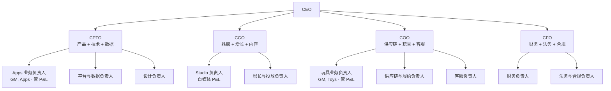

# 公司架构设计：多 App × 实体玩具 × 自媒体

---

## 0. 先纠正一个前提

**C-1 不等于 division。** C-1 有三种完全不同的东西，混在一起画就会画出 30 个部门：

| C-1 的类型 | 例子 | 对什么负责 |
|---|---|---|
| **P&L 单元（division / BU）** | Apps、Toys、Studio | 收入、毛利、增长 |
| **职能（function）** | 财务、法务、HR | 专业标准、成本、风险 |
| **能力域（capability）** | 平台工程、供应链、设计系统 | 交付质量与复用率 |

先进公司的做法：**CEO 的 C-1 里，P&L 单元和职能分开列，绝不交叉。** 一个 BU 里再塞一套财务/HR，就是三家公司各自为政。

---

## 1. C-Suite 岗位清单（2026 年的实际做法）

| 岗位 | 全称 | 真正管什么 | 你这儿 |
|---|---|---|---|
| **CEO** | Chief Executive Officer | 资本配置、三条线的取舍、对外 | ✅ 必须有 |
| **COO** | Chief Operating Officer | 供应链、履约、客服、PMO | ✅ 必须有（玩具逼出来的） |
| **CFO** | Chief Financial Officer | 财务、法务、合规、库存与现金周期 | ✅ 必须有（硬件压现金） |
| **CPTO** | Chief Product & Technology Officer | 产品 + 技术 + 数据 + 安全 | ✅ 必须有，**先合并** |
| **CMO / CGO** | Chief Marketing / Growth Officer | 品牌、增长、投放、渠道 | ✅ 必须有 |
| **CHRO** | Chief Human Resources Officer | 招聘、薪酬、组织 | ⏳ 30 人以下用 HR Lead |
| **CRO / CCO** | Chief Revenue Officer | 统一营收、定价、大客户 | ❌ 暂不设，会和 3 个 GM 打架 |
| **CLO / GC** | Chief Legal Officer / 总法律顾问 | 合同、IP、隐私、产品合规 | ⏳ 先挂 CFO；玩具过认证 + 儿童数据时再独立 |
| **CISO** | Chief Information Security Officer | 安全、等保、渗透测试 | ❌ 不进 C-suite，向 CPTO 汇报 |
| **CDO / CAIO** | Chief Data / AI Officer | 数据资产、模型、AI 落地 | ❌ 作为 CPTO 下的一个域 |
| **CCO** | Chief Customer Officer | 客服体验、留存 | ❌ 并入 COO |
| — | **Chief of Staff** | CEO 办公室、跨线项目 | ⏳ 20–80 人阶段性价比最高，但不是 C |

**三条现代做法：**

1. **C 头衔只给公司级 scope。** BU 一把手叫 GM / SVP，不叫 C。一旦给 BU 老大 C 头衔，他就开始要自己的 CFO 和 CTO。
2. **CEO 直属控制在 6–8 人。** 超过 8 个直接汇报，CEO 就变成路由器而不是决策者。
3. **趋势是合并，不是增加。** CPTO 合并产品与技术、CISO 挂 CTO、CAIO 挂 CTO 是主流；真正在独立的是 CLO（合规压力）和 CDO（数据成为资产）。

---

## 2. 完整架构（Mermaid）

```mermaid
flowchart TD
    CEO["CEO<br/>战略 · 资本配置 · 三条线的取舍"]

    %% ================= 前线：P&L =================
    subgraph FRONT["前线 · 三个 P&L 单元"]
        direction TB

        subgraph APP["Apps 应用矩阵"]
            direction TB
            GM_APP["GM, Apps<br/>应用组合 · 订阅收入"]
            A1["产品组合负责人<br/>Group PM · 排优先级"]
            A2["增长与变现负责人<br/>ASO · 订阅 · 内购广告"]
            A3["App 小队 ×N<br/>PM · 设计 · 工程 · 增长"]
            GM_APP --> A1
            GM_APP --> A2
            A1 --> A3
        end

        subgraph TOY["Toys 实体玩具"]
            direction TB
            GM_TOY["GM, Toys<br/>选品 · 定价 · 渠道"]
            T1["产品与品类<br/>IP 形象 · 模具 · 包装"]
            T2["渠道与销售<br/>DTC · 亚马逊 · 线下零售"]
            T3["品质与合规<br/>EN71 · ASTM · CPSIA · 召回"]
            GM_TOY --> T1
            GM_TOY --> T2
            GM_TOY --> T3
        end

        subgraph MEDIA["Studio 自媒体"]
            direction TB
            HEAD_MED["Head of Studio<br/>自有 P&L · 内部结算"]
            M1["内容制作<br/>编导 · 拍摄 · 剪辑"]
            M2["商业化<br/>广告 · 商单 · IP 授权"]
            M3["社群与分发<br/>多平台矩阵 · 数据复盘"]
            HEAD_MED --> M1
            HEAD_MED --> M2
            HEAD_MED --> M3
        end
    end

    %% ================= 中场：共享能力 =================
    subgraph MID["中场 · 共享能力平台"]
        direction TB

        subgraph TECH["CPTO 产品与技术"]
            direction TB
            CPTO["CPTO"]
            P1["平台工程<br/>账号 · 支付 · 数据管道 · 推送"]
            P2["数据与 AI<br/>推荐 · 素材生成 · 归因"]
            P3["设计与品牌系统<br/>设计系统 · 资产库 · 一致性"]
            P4["安全与 IT<br/>账号安全 · 隐私 · 办公 IT"]
            CPTO --> P1
            CPTO --> P2
            CPTO --> P3
            CPTO --> P4
        end

        subgraph MKT["CMO / CGO 品牌与增长"]
            direction TB
            CMO["CMO / CGO"]
            B1["品牌与创意<br/>定位 · VI · 大创意"]
            B2["增长与投放<br/>ASA · Meta · TikTok · KOL"]
            B3["内容营销<br/>选题 · 排期 · 素材"]
            CMO --> B1
            CMO --> B2
            CMO --> B3
        end
    end

    %% ================= 后台：治理 =================
    subgraph BACK["后台 · 治理与支撑"]
        direction TB

        subgraph FIN["CFO 财务与法务"]
            direction TB
            CFO["CFO"]
            F1["FP&A 与经营分析<br/>分线 P&L · 单位经济"]
            F2["会计 · 税务 · 资金<br/>库存 · 现金周期"]
            F3["法务与合规<br/>隐私 · 广告法 · IP · 合同"]
            CFO --> F1
            CFO --> F2
            CFO --> F3
        end

        subgraph OPS["COO 运营与供应链"]
            direction TB
            COO["COO"]
            O1["供应链与制造<br/>验厂 · 打样 · 生产 · 物流"]
            O2["客服与售后<br/>App 支持 · 玩具退换"]
            O3["PMO 与流程<br/>跨线项目 · 节奏管理"]
            COO --> O1
            COO --> O2
            COO --> O3
        end

        subgraph PPL["CHRO 组织与人才"]
            direction TB
            CHRO["CHRO"]
            H1["招聘<br/>产品 · 工程 · 内容"]
            H2["薪酬与绩效<br/>分线激励 · 期权"]
            H3["组织发展<br/>职级 · 文化 · 培训"]
            CHRO --> H1
            CHRO --> H2
            CHRO --> H3
        end
    end

    %% ================= 汇报关系 =================
    CEO --> GM_APP
    CEO --> GM_TOY
    CEO --> HEAD_MED
    CEO --> CPTO
    CEO --> CMO
    CEO --> CFO
    CEO --> COO
    CEO --> CHRO

    %% ================= 矩阵（虚线）=================
    CPTO -. "工程派驻 · 平台复用" .-> A3
    COO -. "生产与履约" .-> GM_TOY
    CMO -. "品牌内容 · 内部结算" .-> HEAD_MED
    CMO -. "投放与素材" .-> GM_APP
```



---

## 3. 精简起步版：4 个 C 就能跑

人不到 50 时，上面那张图里有一半是**岗位说明书**，不是真人。这是能落地的版本：



差别只有一处：**Apps 的 GM 挂 CPTO，Toys 的 GM 挂 COO。** 因为人少时，产品和技术是同一批人，玩具和供应链是同一批人。等每条线都过千万级收入、需要独立融资或独立品牌时，再把两个 GM 提到 CEO 直属。

---

## 4. ASCII 速览

```
                                   ┌─────────┐
                                   │   CEO   │
                                   └────┬────┘
        ┌───────────────┬───────────────┼───────────────┬───────────────┐
        │               │               │               │               │
   ┌────▼────┐     ┌────▼────┐     ┌────▼────┐     ┌────▼────┐     ┌────▼────┐
   │GM, Apps │     │GM, Toys │     │ Head of │     │  CPTO   │     │   CMO   │
   │  P&L    │     │  P&L    │     │ Studio  │     │产品+技术 │     │品牌+增长 │
   └────┬────┘     └────┬────┘     │  P&L    │     └────┬────┘     └────┬────┘
        │               │          └────┬────┘          │               │
   ┌────┴─────┐    ┌────┴─────┐    ┌────┴─────┐   ┌────┴─────┐    ┌────┴─────┐
   │产品组合   │    │产品与品类 │    │内容制作   │   │平台工程   │    │品牌与创意 │
   │增长与变现 │    │渠道与销售 │    │商业化     │   │数据与 AI  │    │增长与投放 │
   │App 小队×N │    │品质与合规 │    │社群与分发 │   │设计系统   │    │内容营销   │
   └──────────┘    └──────────┘    └──────────┘   │安全与 IT  │    └──────────┘
                                                   └──────────┘

        ┌───────────────┬───────────────┬───────────────┐
        │               │               │               │
   ┌────▼────┐     ┌────▼────┐     ┌────▼────┐         │
   │   CFO   │     │   COO   │     │  CHRO   │         │
   │财务+法务 │     │运营+供应链│     │组织+人才 │         │
   └────┬────┘     └────┬────┘     └────┬────┘         │
        │               │               │               │
   ┌────┴─────┐    ┌────┴─────┐    ┌────┴─────┐         │
   │FP&A      │    │供应链制造 │    │招聘       │         │
   │会计税务   │    │客服售后   │    │薪酬绩效   │         │
   │法务合规   │    │PMO       │    │组织发展   │         │
   └──────────┘    └──────────┘    └──────────┘         │

   矩阵（虚线）：
   CPTO ┈┈▶ App 小队（工程派驻，代码一套）
   COO  ┈┈▶ GM, Toys（生产与履约，工厂一套）
   CMO  ┈┈▶ Studio（品牌内容，走内部结算价）
```

---

## 5. 为什么这样切：三条业务的差异

| 维度 | Apps | Toys | Studio |
|---|---|---|---|
| 成本结构 | 边际成本≈0，人贵 | 模具 + 库存 + 物流，现金压得重 | 人力密集，产能有上限 |
| 核心指标 | 留存、LTV、CAC | 毛利率、周转、退货率 | 播放、粉丝质量、商单单价 |
| 最大风险 | 平台政策、隐私合规 | 安全认证、召回、汇率 | 账号封禁、内容合规 |
| 必须自建 | 无（都可复用） | 品质与合规 | 内容与人格 |
| 必须共享 | 工程 / 设计 / 数据 | 供应链 / 履约 | 品牌 / 投放 |

**结论：三份"必须自建"留在 BU，"必须共享"抽到平台。** 这条规则就是整张图的生成逻辑——

- Apps 的工程不放在 BU 里，放在 CPTO；BU 只留产品和增长，因为一个 App 的成功不可复制给下一个 App，但一套账号/支付/数据管道可以。
- Toys 的供应链不放在 BU 里，放在 COO；BU 只留"选什么品、卖给谁、什么价"，因为工厂和物流是同一套。
- Studio 不能被塞进市场部。它有自己的收入和自己的受众，必须独立 P&L；否则永远给两条业务线做免费素材，永远长不出商业能力。给 CMO 一条虚线，用**内部结算价**买它的产能。

---

## 6. 五个容易踩的坑

1. **把 C-1 当"部门"。** C-1 应该是"能独立交付结果的最小单元"。画出 30 个部门，等于没人对结果负责。
2. **三条线各建一套工程/设计/供应链。** 成本三倍，且三个月后互相不兼容。
3. **Studio 没有结算规则。** 业务线白嫖内容，Studio 做不出 P&L，最后变成一个"高薪剪辑组"。
4. **玩具的合规扔给法务。** 玩具安全是**质量体系**（验厂、抽检、批次追溯、召回预案），不是合同审阅。它必须在 Toys BU 里有实权。
5. **过早设 CRO / CCO / CLO。** 头衔通胀，决策链变长，而且 CRO 一定会和 3 个 GM 抢定价权。

---

## 7. 落地顺序

1. **先划 P&L 边界**：三个 GM 各自对什么数字负责，共享成本怎么摊（这是整套架构的地基，比画组织图重要十倍）。
2. **CPTO**（一个人把产品和技术收口，避免 App 之间重复造轮子）。
3. **CMO / CGO**（三条线都要流量，这是最容易被重复建设的地方）。
4. **CFO**（库存和现金周期必须先看清，否则玩具越卖越缺钱）。
5. **COO**（玩具起量前置，不然爆单就是灾难）。
6. **CHRO**（到 30 人再设）。
7. **CLO**（等玩具要过认证、App 要碰儿童数据时独立）。
